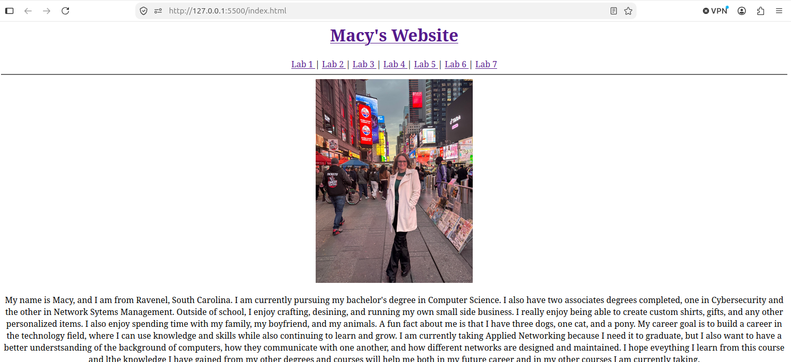
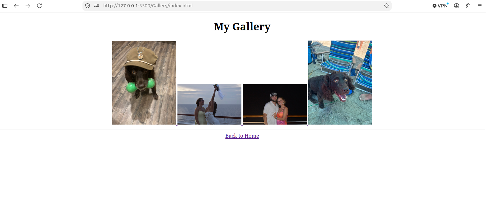
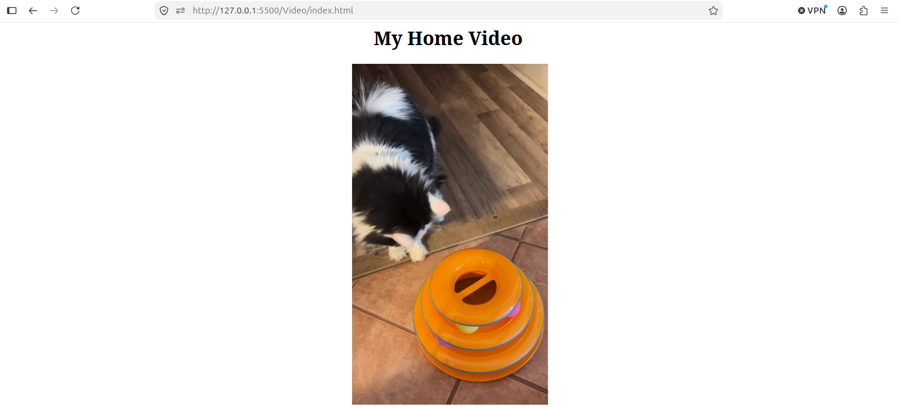

[Back to Portfolio](./)

Personal Multi-Page Website
===============

-   **Class: CSCI 332- Applied Networking** 
-   **Grade: Pending** 
-   **Language(s): HTML** 
-   **Source Code Repository:** [csci332-personal-website](https://github.com/macymwillis/csci332-personal-website)  
    (Please [email me](mailto:MMWillis@student.csuniv.edu?subject=GitHub%20Access) to request access.)

## Project description

This project involved developing and publishing a personal multi-page website using HTML for CSCI 332 Applied Networking. The website includes a homepage with personal information, background music, and navigation links to additional pages. Additional features include a family page, a photo gallery with clickable image thumbnails, a video page, and links to previous lab assignments. The website was published using Apache and tested locally to verify that navigation, images, audio, and video worked correctly. This project provided hands-on experience integration, web server publishing, and testing website functionality. 

## How to Run the Project
This project does not require compilation because it was created using HTML.

To run the website:
1. Open the Ubuntu virtual machine.
2. Start the Apache web server.
3. Open a web browser.
4. Enter http://localhost in the address bar.
5. Use the navigation menu to visit the different pages.
   
The website uses HTML files and supporting media files, including images, audio, and video. Keep these files in their appropriate folder for the website to function correctly.

## UI Design

The website uses a multi-page layout to organize personal information and multimedia content. A navigation menu allows visitors to move between the homepage, family page, photo gallery, video page, and individual lab assignment pages. 
The homepage displays a personal introduction and picture, along with background music. The photo gallery presents images as clickable thumbnails, allowing visitors to open the full-size pictures. A separate video included with the website files. 
The website was organized using HTML files and separate folders for its pages and media resources. It was published through Apache and tested locally to check that the navigation links, images, audio, and video function correctly. 

  
Fig 1. The Homepage of The Website.

  
Fig 2. The Photo Gallery Page.

  
Fig 3. The Home Video page.

## 3. Additional Considerations

This project helped me gain practical experience creating and publishing a multi-page website. I learned how to organize HTML files, link pages together, include images and multimedia, and use Apache to host and test a website locally. 
One challenge was ensuring that the website's navigation links and media files worked correctly. Organizing the files into the appropriate folders helped keep the website structured and functional.

[Back to Portfolio](./)
