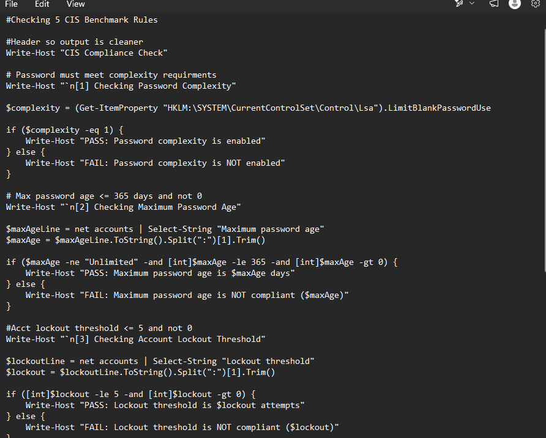
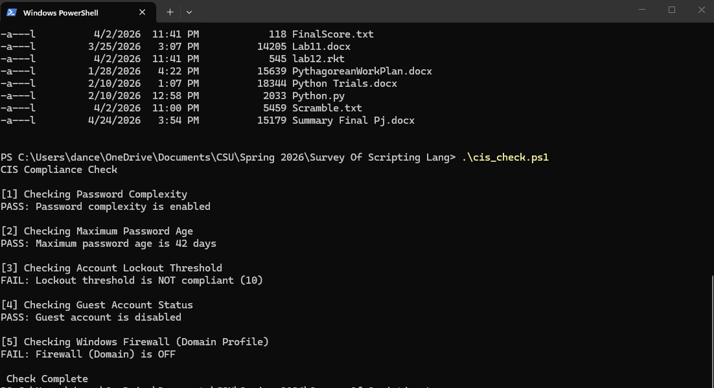

[Back to Portfolio](./)

CIS Security Compliance Checker
===============

-   **Class: CSCI 301 Survey of Scripting Languages** 
-   **Grade: 100%** 
-   **Language(s): PowerShell** 
-   **Source Code Repository:** [csci332-personal-website](https://github.com/macymwillis/csci332-personal-website)  
    (Please [email me](mailto:MMWillis@student.csuniv.edu?subject=GitHub%20Access) to request access.)

## Project description

This project involved developing a PowerShell script to check a Windows workstation's compliance with
five security rules selected from the Center for Internet Security (CIS) Benchmarks. The script checks 
password complexity requirements, maximum password age, account lockout threshold, guest account status,
and the Windows Firewall Domain Profile state.

The program reports whether each security setting passes or fails the selected requirements. The script
only checks the settings and does not modify or configure them.

This project provided experience using PowerShell access. Windows security configurations
programmatically. A challenge was identifying the appropriate commands and registry locations 
needed to check the different security policies.

## How to Run the Project
This project does not require compilation because it is written in PowerShell.

To run the website:
1. Use a Windows computer with PowerShell available.
2. Save or download the PowerShell script (.ps1) to the computer.
3. Open PowerShell.
4. Navigate to the folder containing the script.
5. Run the script according to your system's PowerShell execution policy.
   
The script checks the selected security settings and displays PASS or FAIL results in the PowerShell
window. It is designed to check settings rather than change them.

## UI Design

This project uses a text-based interface in the PowerShell terminal. When the script runs, it displays 
a heading followed by five numbered security checks. Each check prints a PASS or FAIL message based on 
the setting being evaluated. 

The results are organized by security rule, making it easier to identify which settings meet the selected 
requirements. A completion message appears after all five checks have run.

  
Fig 1. PowerShell Code.

  
Fig 2. Programming Running in PowerShell.

## 3. Additional Considerations

This project helped me learn how to inspect Windows security configurations through scripting and 
understand how security policies support workstation standards in a corporate environment. I also 
learned that different security settings may require different PowerShell commands or methods to 
retrieve their values.

[Back to Portfolio](./)
