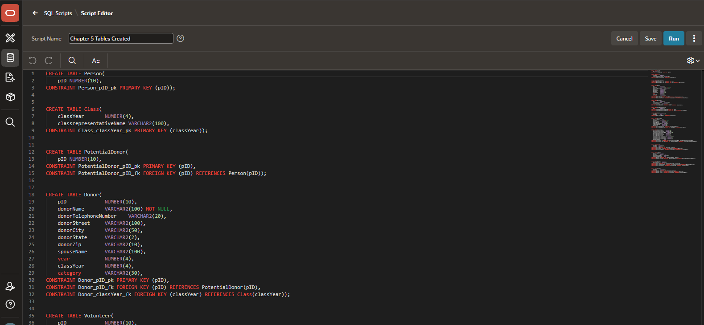
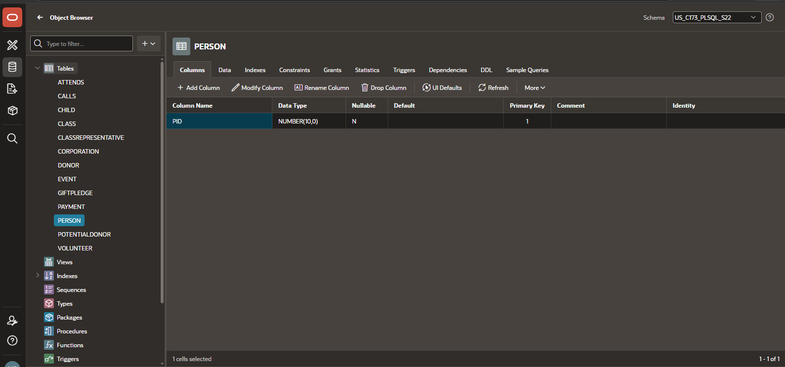

[Back to Portfolio](./)

Beta University Database Table Design
===============

-   **Class: CSCI 419 Database Management** 
-   **Grade: 100%** 
-   **Language(s): SQL** 
-   **Source Code Repository:** [csci301-compliance-checker](https://github.com/macymwillis/csci301-compliance-checker)  
    (Please [email me](mailto:MMWillis@student.csuniv.edu?subject=GitHub%20Access) to request access.)

## Project description

This project involved creating relational database tables for the Beta University Annual Fund 
database. The database was designed to organize information about people, donors, potential 
donors, volunteers, classes, events, children, and gift pledges.

SQL CREATE TABLE statements were used to define the structure of the database. Primary keys were 
established to uniquely identify records, and foreign keys were used to define relationships 
between related tables.

The project provided experience with relational database design, table creation, and the use of 
primary and foreign key constraints to maintain relationships between database records.

## How to Run the Project

1. Open Oracle APEX and access the appropriate workspace.
2. Navigate to SQL Workshop.
3. Open SQL Scripts or SQL Commands.
4. Use the SQL table-creation statements in the source code.
5. Execute the statements in the appropriate order so that referenced tables exist before
   dependent tables are created.
7. Review the results to confirm that the tables were created successfully.

The SQL statements are intended to define the database structure. They should be run in an 
appropriate database workspace.

## UI Design

This project focuses on database structure rather than a graphical user interface. Oracle APEX 
was used to work with and execute the SQL statements.

The database structure is defined through SQL statements that specify table names, columns, 
data types, primary keys, and foreign keys. These definitions establish how information is 
organized and how related records connect across tables.

  
Fig 1. Shows the SQL script of CREATE TABLE statements.

  
Fig 2. Showing results.

## 3. Additional Considerations

This project helped me learn how to inspect Windows security configurations through scripting and 
understand how security policies support workstation standards in a corporate environment. I also 
learned that different security settings may require different PowerShell commands or methods to 
retrieve their values.

[Back to Portfolio](./)
